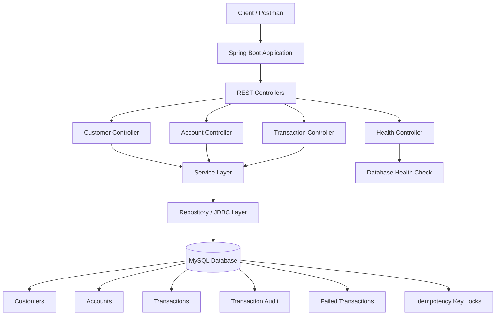

# Banking Transaction Processing System — Architecture

## System Architecture

## Main Components

1. **Client:** Sends HTTP requests using Postman.
2. **Controller Layer:** Handles REST API requests.
3. **Service Layer:** Contains banking business logic.
4. **Repository / JDBC Layer:** Executes SQL operations using JDBC.
5. **MySQL:** Stores customer, account, transaction, audit, and failure records.

## Transaction Processing

- Deposit
- Withdrawal
- Transfer
- Account locking
- Idempotency handling
- Transaction auditing
- Failed transaction tracking

## Performance Testing

The performance testing component executes concurrent deposits using 1, 5, 10, and 20 worker threads against the separate performance database.
