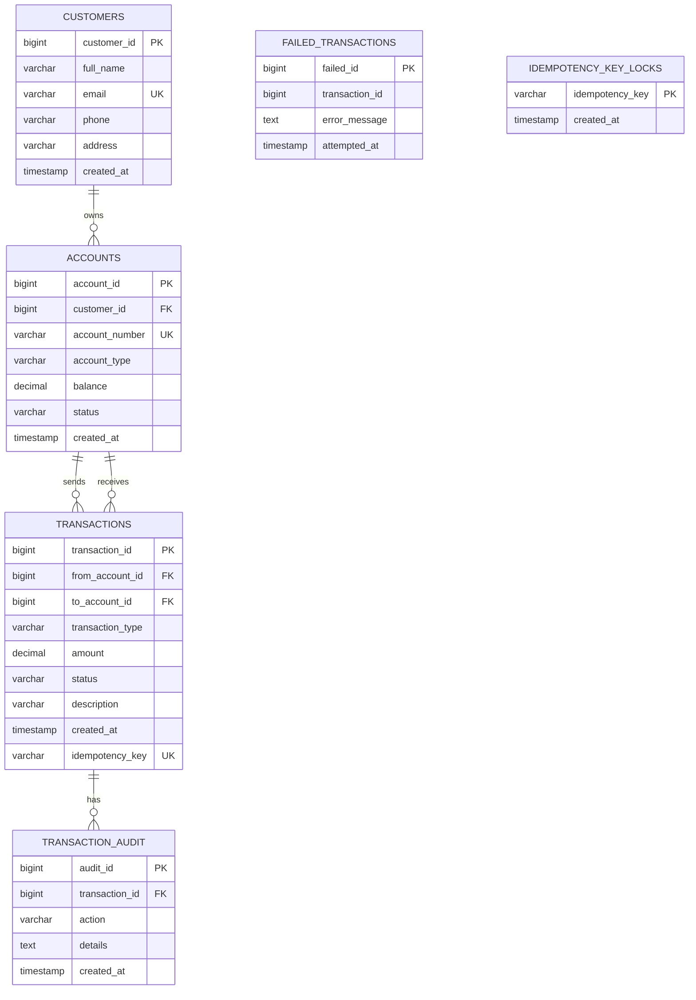

# Banking Transaction Processing System — ER Diagram

## Entity Relationship Diagram

## Relationship Description

1. One customer can own multiple accounts.
2. One account can send multiple transactions.
3. One account can receive multiple transactions.
4. One transaction can have multiple audit records.
5. Failed transactions store information about unsuccessful operations.
6. Idempotency key locks help coordinate requests using the same idempotency key.
